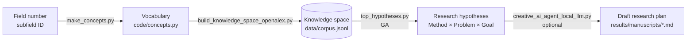
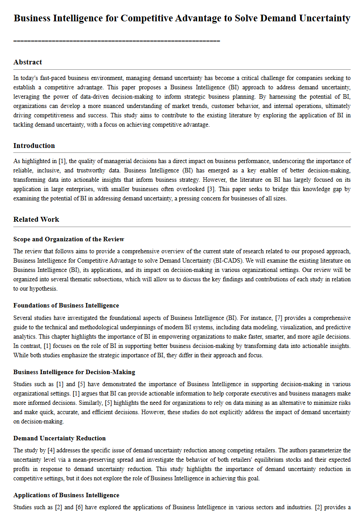
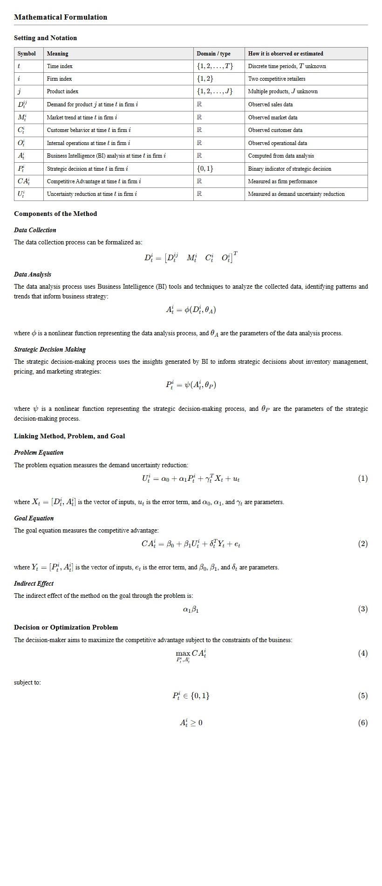

# Generating research hypotheses for your own field with a genetic algorithm and a local LLM

*English version of the Japanese tutorial on Zenn: https://zenn.dev/otsukilabo_nuce/articles/0d8bdf741c27c5 (日本語版はこちら)*

> [!WARNING]
> **Before you start**
> - The code in this tutorial is published so that the results of the paper can be reproduced and reused. **Individual support (installation or runtime problems, environment-specific issues, questions about usage) cannot be provided.**
> - You use the code, and its outputs (generated hypotheses, draft research plans, cited references), **at your own responsibility**. The author accepts no liability for any damage arising from their use.
> - **Some IT literacy is required.** The tutorial assumes that you can:
>   - run commands and change folders in PowerShell (or a terminal);
>   - set up Python (installation, virtual environments, installing libraries with `pip`);
>   - set environment variables and make simple edits to Python files (settings and word lists);
>   - read error messages and look up their causes;
>   - (optional steps 5–6) download llama.cpp and an LLM model and put the files in place.
> - If you publish research results (papers, conference talks, etc.) based on hypotheses or drafts generated by this agent, **please cite the paper below** (see [Citation](#citation)).
> - The code is released under the MIT license (no warranty). Use external services such as OpenAlex, arXiv and Hugging Face according to their own terms.

## Introduction

This tutorial shows how to use the code published with the paper

> Otsuki A. Comparing Genetic Algorithms and LLMs for Research-Hypothesis Generation: Mainstream Convergence of LLMs, Wider Hypothesis Exploration by Combinatorial Search, and the Limits of Literature-Distance Novelty Metrics. Informatics. 2026; 13(10):174. https://doi.org/10.3390/informatics13100174

to let an AI agent **propose new research hypotheses in your own field**.

An introduction video (YouTube) explains the background and the main results of the paper: https://www.youtube.com/watch?v=aPR7MMKVEB0

The agent has four parts:

1. **Vocabulary**: lists of "Method", "Problem" and "Goal" terms of the field. It can be **built automatically** from the keywords that the field's papers use most often.
2. **Knowledge space**: papers of the field (title + abstract), embedded as sentence vectors.
3. **Genetic algorithm (GA)**: evolves Method × Problem × Goal combinations and searches for hypotheses that are far from existing work but still supported by the literature.
4. **Local LLM (optional)**: writes a draft research plan from a selected hypothesis.

The free **OpenAlex** database is used for the literature; everything else runs **on your own PC**. No paid service such as Claude or ChatGPT is used.

> [!NOTE]
> **What you should know first (from the conclusions of the paper)**
>
> The hypotheses produced by this agent have been shown to be "far from existing papers" and "broader than what an LLM proposes on its own". However, **the agent does not guarantee that a hypothesis is original or valuable.** The paper also reports that a novelty measure based on distance to the literature was almost unrelated to the ratings of ICLR reviewers (ρ ≤ 0.06), and the effect was tested only in the field of AI. Treat the output as "candidate ideas" and **let humans make the final judgment.**

## Overview



| Step | What you do | Time (CPU only) |
|---|---|---|
| Preparation | Set up the environment, get an OpenAlex API key | 20–30 min |
| Step 0 | Find the number of your field | a few minutes |
| Steps 1–2 | Build the vocabulary automatically, check it, and write it | a few minutes (plus manual fixes if needed) |
| Step 3 | Build the knowledge space | a few minutes |
| Step 4 | Generate hypotheses | 2–3 min the first time |
| Steps 5–6 (optional) | Turn a hypothesis into a draft research plan with a local LLM | from minutes to tens of minutes |

## Requirements

The environment used by the author:

- Windows 11 (the Python part works the same way on macOS / Linux)
- Python 3.13
- 16 GB of RAM or more recommended (more for step 5, depending on the size of the LLM)
- A GPU is not required (step 5 is much faster with one)
- An internet connection (for OpenAlex queries and the first download of the embedding model)

## Preparation 1: set up the environment

### Get the repository

```bash
git clone https://github.com/otsukiLabo-NUCOE/creative-ai-hypothesis-generation.git
cd creative-ai-hypothesis-generation
```

Without git, download and extract the ZIP file instead (or use "Code" → "Download ZIP" on GitHub):

```text
https://github.com/otsukiLabo-NUCOE/creative-ai-hypothesis-generation/archive/refs/tags/v1.0.5.zip
```

Every version is also archived on Zenodo.

| Version | DOI | Contents |
|---|---|---|
| **v1.0.5 (matches this tutorial)** | https://doi.org/10.5281/zenodo.23860326 | The sample manuscript in `examples/` is replaced by one made with `--seed 5`, as in step 6 of this tutorial. A draft is no longer lost when the LLM server returns an error |
| v1.0.4 | https://doi.org/10.5281/zenodo.23858501 | Warnings when a step is skipped; detailed rewriting of Related Work, Mathematical Formulation and Experimental Design; Reproducibility written from the recorded settings; sample manuscript (`examples/`) |
| v1.0.3 | https://doi.org/10.5281/zenodo.23794416 | Real papers from the knowledge space are cited in the draft |
| v1.0.2 | https://doi.org/10.5281/zenodo.23791647 | Scripts for using the agent in your own field (`make_concepts.py`, etc.) |
| v1.0.1 (cited in the paper) | https://doi.org/10.5281/zenodo.23290094 | Code, data and logs of the experiments in the paper |

> [!NOTE]
> `make_concepts.py`, `build_knowledge_space_openalex.py` and `top_hypotheses.py` are included **from v1.0.2**; citing real papers in the draft is available **from v1.0.3**.

### Create a virtual environment and install the libraries

```bash
python -m venv .venv
# Windows
.venv\Scripts\activate
# macOS / Linux
source .venv/bin/activate

pip install -r requirements.txt
```

<details>
<summary>If downloading torch is too heavy on a PC without a GPU</summary>

`torch` in `requirements.txt` may fetch the CUDA build. If the CPU build is enough, run the following first and then `pip install -r requirements.txt`.

```bash
pip install torch --index-url https://download.pytorch.org/whl/cpu
```
</details>

### Main files

| Path | Contents |
|---|---|
| `code/make_concepts.py` | Builds the vocabulary (`concepts.py`) for a given field |
| `code/build_knowledge_space_openalex.py` | Builds the knowledge space (`data/corpus.jsonl`) from OpenAlex |
| `code/top_hypotheses.py` | Generates hypotheses with the GA and shows the top hypotheses of all combinations |
| `code/creative_ai_agent_local_llm.py` | Turns a selected hypothesis into a draft research plan with a local LLM (citing real papers) |
| `code/concepts.py` | The vocabulary (Method, Problem and Goal lists); rewritten in step 2 |
| `code/creative_ga.py` | The proposed model (embeddings, novelty, utility, GA) |
| `prompts/` | Prompts given to the LLM |
| `examples/` | An unedited sample manuscript (see [Sample output](#sample-output)) |

## Preparation 2: get a free OpenAlex API key

**OpenAlex** is a free database of scholarly works worldwide (titles, abstracts, keywords, etc.; https://openalex.org ). It also covers business, economics, medicine and the humanities.

It can be used without a key, but then **all users of the same network share a budget of about 100 requests per day** (on a university network it may be used up by others quickly). Building a knowledge space needs about 60 requests, so **a free API key is strongly recommended.**

1. Open https://openalex.org/settings/api, register your e-mail address and get a key.
2. Set the key as an environment variable in the PowerShell window (or terminal) where you run the steps.

```powershell
# Windows PowerShell (valid until the window is closed)
$env:OPENALEX_API_KEY = "your key"
```

```bash
# macOS / Linux
export OPENALEX_API_KEY="your key"
```

## Generating hypotheses for your field (example: management information systems)

The following steps use **Management Information Systems (MIS)** as the example. **Run steps 0–4 in the same PowerShell window** (closing the window removes the API key setting).

First, move to the `code` folder of the repository.

```powershell
cd <where you put the repository>\creative-ai-hypothesis-generation\code
```

### Step 0: find the number of your field

OpenAlex classifies papers into fields, each with a number (subfield ID). Open the following URL in a browser, putting the field name **in English** after `search=` (write spaces as `%20`).

```text
https://api.openalex.org/subfields?search=management%20information&select=id,display_name,field
```

You will see something like this (formatted for readability):

```json
{
  "results": [
    {
      "id": "https://openalex.org/subfields/1404",
      "display_name": "Management Information Systems",
      "field": { "id": "https://openalex.org/fields/14", "display_name": "Business, Management and Accounting" }
    },
    { "id": "https://openalex.org/subfields/1802", "display_name": "Information Systems and Management", ... },
    { "id": "https://openalex.org/subfields/3605", "display_name": "Health Information Management", ... }
  ]
}
```

- Find the result whose `"display_name"` is your field. The **last number** of its `"id"` is the field number. For MIS it is **1404**.
- The last number of the `"id"` under `"field"` (**14** for MIS) is used in step 3.
- `&select=id,display_name,field` at the end of the URL shows only the necessary items. Without it, the list of all fields at the same level (`"siblings"`) is shown as well, and the number is hard to find.

<details>
<summary>Numbers of some fields</summary>

| Field | subfield ID | field |
|---|---|---|
| Management Information Systems | 1404 | 14 |
| Information Systems and Management | 1802 | 18 |
| Strategy and Management | 1408 | 14 |
| Marketing | 1406 | 14 |
| Economics and Econometrics | 2002 | 20 |
| Artificial Intelligence | 1702 | 17 |
| Information Systems | 1710 | 17 |
| Control and Systems Engineering | 2207 | 22 |
| Health Information Management | 3605 | 36 |
| Philosophy | 1211 | 12 |
| History and Philosophy of Science | 1207 | 12 |
</details>

### Step 1: build the vocabulary automatically and check it

With `--dry-run`, the vocabulary is only shown; `concepts.py` is not changed.

```powershell
python make_concepts.py --subfield 1404 --dry-run
```

`make_concepts.py` fetches from OpenAlex the 200 keywords used most often by papers of the field, and assigns them to Method, Problem, Goal or "excluded" by fixed rules (no generative AI is used).

Example output (MIS, papers from 2021–2025):

```text
200 keywords fetched from OpenAlex

Method (12):
  - Decision Support System
  - Enterprise Resource Planning
  - Business Intelligence
  - Artificial Intelligence
  - Process Mining
  - Data-driven Decision Making
  - Balanced Scorecard
  - Accounting Information Systems
  - Big Data
  - Blockchain
  - Demand Forecasting
  - Predictive Analytics

Problem (9):
  - Risk Management
  - Demand Uncertainty
  - Data Security
  - Information Asymmetry
  - Information Sharing
  - Data Privacy
  - Implementation Barriers
  - Cybersecurity
  - Supply Chain Disruption

Goal (8):
  - Competitive Advantage
  - Operational Efficiency
  - Firm Performance
  - Customer Satisfaction
  - Organizational Performance
  - Continuous Improvement
  - Cost Reduction
  - Key Performance Indicators

excluded as context/noise (first 15): ['inventory management', 'fintech', 'supply chain management',
 'small and medium-sized enterprises', 'digital transformation', ..., 'COVID-19 pandemic', 'exam dumps', ...]
```

Check whether the Method, Problem and Goal lists **are reasonable vocabulary for your field**. The last line shows keywords that were excluded (words for objects or contexts, and noise).

- **If they are reasonable** → go to step 2.
- **If some words are wrong** (e.g. a method listed as a problem, or an important keyword excluded) → fix them as described in [When the vocabulary is not built well](#when-the-vocabulary-is-not-built-well) and check again with `--dry-run`.

<details>
<summary>Options of make_concepts.py</summary>

| Option | Default | Meaning |
|---|---|---|
| `--subfield` | — | OpenAlex field number |
| `--search` | — | Narrow the papers by keywords instead of (or in addition to) the field number (e.g. `--search "digital transformation"`) |
| `--from` / `--to` | 2021-01-01 / 2025-12-31 | Period of the papers whose keywords are counted |
| `--n-method` / `--n-problem` / `--n-goal` | 12 / 10 / 8 | Number of words per role (upper limit; fewer if not enough words qualify) |
| `--margin` | 0.08 | Threshold for assigning a keyword without a cue word by embeddings alone (see below) |
| `--dry-run` | — | Show only, do not write |
</details>

### Step 2: write the vocabulary to concepts.py

Run the same command without `--dry-run`.

```powershell
python make_concepts.py --subfield 1404
```

It is done when `concepts.py updated (... hypotheses)` is shown. The previous file is kept as `concepts.py.bak`. In this example, the search space is 12 Methods × 9 Problems × 8 Goals = 864 hypotheses.

> [!NOTE]
> **The scripts warn you when a step is skipped (from v1.0.4).**
> For example, when step 3 is run without writing the vocabulary, when the field of the vocabulary does not match `FIELDS`, or when the vocabulary was changed but the knowledge space was not rebuilt. If a script stops, follow the message (to continue anyway, type `y` or run it with `--force`). The meaning of each warning is listed in [Troubleshooting](#troubleshooting).

> [!WARNING]
> **Whenever you change the vocabulary, rebuild the knowledge space in step 3.** A freshly extracted folder contains the AI knowledge space used in the paper's experiments. If you skip step 3, MIS hypotheses are compared with AI papers: novelty looks higher than it is, and unrelated papers are chosen as references (from v1.0.4 a warning is shown in this case).

### Step 3: build the knowledge space (a few minutes)

Collect papers from OpenAlex with the vocabulary.

```powershell
python build_knowledge_space_openalex.py
```

It is done when `done: {'past': ..., 'future': ...}` is shown. The result is saved in `data/corpus.jsonl`.

- Papers found by searching for each vocabulary term and papers sampled at random from the whole field are collected.
- `past` are **the papers the GA compares with** (by default January 2021 – June 2025); `future` are papers held out for evaluation (July – December 2025).

> [!WARNING]
> **For fields other than MIS, change `FIELDS`.**
> `FIELDS` at the top of `build_knowledge_space_openalex.py` is the number of the broad category (field) from which papers are collected. The default is `"14|17|18"` for MIS (Business, Management and Accounting / Computer Science / Decision Sciences). Change it to the `"field"` number you noted in step 0 (e.g. `"12"` for philosophy). Join several categories with `|`.

### Step 4: generate hypotheses

```powershell
python top_hypotheses.py
```

The hypotheses found by the GA (seeds 1–5) and the top 10 of all combinations are shown.

Example output (MIS; it depends on the period and the papers collected):

```text
--- GA (seed 1-5)
seed=1: Demand Forecasting for Organizational Performance to solve Data Privacy  N=0.503 U=0.629 f=0.554
seed=2: Decision Support System for Continuous Improvement to solve Risk Management  N=0.501 U=0.606 f=0.543
...
--- top 10 of all combinations
Demand Forecasting for Organizational Performance to solve Data Privacy  N=0.503 U=0.629 f=0.554
Decision Support System for Continuous Improvement to solve Risk Management  N=0.501 U=0.606 f=0.543
Artificial Intelligence for Cost Reduction to solve Information Asymmetry  N=0.556 U=0.518 f=0.541
...
```

For example, "Artificial Intelligence for Cost Reduction to solve Information Asymmetry" is the hypothesis "use AI to address information asymmetry and thereby reduce costs".

**Meaning of the scores**

| Symbol | Meaning | How it is computed |
|---|---|---|
| **N** (novelty) | How far the hypothesis is from existing papers | The hypothesis sentence (e.g. "Using AI to address Information Asymmetry in order to improve Cost Reduction.") and each paper of the knowledge space are embedded; N is 1 minus the **similarity to the most similar paper** |
| **U** (utility) | How well each pair of the combination is supported by the literature | The mean literature support of the three pairs Method × Problem, Method × Goal and Problem × Goal |
| **f** (fitness) | The value the GA maximizes | f = 0.6 N + 0.4 U |

A high N alone tends to give "odd, meaningless combinations"; a high U alone gives "commonplace combinations". The GA looks for hypotheses in between. The GA settings (population 10, 20 generations, 200 evaluations, etc.) are at the top of `code/creative_ga.py`.

### Step 5 (optional): start the local LLM server

A selected hypothesis can be turned into a draft research plan by a local LLM. The first time, prepare llama.cpp and a model.

1. Download and extract a build for your environment from https://github.com/ggml-org/llama.cpp/releases.
   - Windows without a GPU: `llama-bXXXX-bin-win-cpu-x64.zip`
   - Windows with an NVIDIA GPU: `llama-bXXXX-bin-win-cuda-12.4-x64.zip` and `cudart-llama-bin-win-cuda-12.4-x64.zip` (**extract both directly into the same folder**)
2. Download a model in GGUF format from Hugging Face. Models of about 8B parameters run reasonably on a CPU (e.g. the Q8_0 version of Llama-3.1-8B-Instruct, about 8 GB).

**Open a second PowerShell window**, move to the folder that contains `llama-server.exe`, and start the server (adjust the paths to your environment).

```powershell
cd C:\llama.cpp
.\llama-server.exe -m "<path to the model>\Meta-Llama-3.1-8B-Instruct-Q8_0.gguf" --port 8080 -c 8192 --jinja
```

- `C:\llama.cpp` is an example of the folder where llama.cpp was extracted. If `llama-server.exe` is in a subfolder (e.g. `build\bin`), `cd` to that folder.
- `.\` means "in the current folder". PowerShell needs it to run a program in the current folder (without it you get a "not recognized" error).
- You can also run it without `cd`, giving the full path, e.g. `C:\llama.cpp\llama-server.exe -m …`.
- After `-m`, give the path of the model (`.gguf` file) downloaded in item 2 above, enclosed in `"`.

After a while, the following is **displayed automatically**:

```text
llama_server: model loaded
llama_server: listening on http://127.0.0.1:8080
```

> [!WARNING]
> The two lines above are **an example of what the screen shows**. Do not type them into PowerShell (if you do, you get the error "The term 'llama_server:' is not recognized as the name of a cmdlet…"; the error is harmless).

The server is ready when `listening on http://127.0.0.1:8080` is shown. **Keep this window open until the draft is finished.** To stop the server, press **Ctrl+C** in this window.

### Step 6 (optional): let the LLM write a draft research plan

In **the original PowerShell window (where you ran steps 0–4)**, run:

```powershell
$env:LLAMA_SERVER_MODEL_NAME = "Llama-3.1-8B-Instruct"
python creative_ai_agent_local_llm.py --seed 5 --source ga
```

- Change the number in `--seed 5` to the seed of the hypothesis you want to write up. With the same seed as in "GA (seed 1-5)" of step 4, the same hypothesis is used (here, the hypothesis of seed 5).
- `LLAMA_SERVER_MODEL_NAME` is the model name recorded in the log (the model actually used is the one started in step 5).
- The hypothesis used is shown first, as `[ga, seed=5] … (N=…, U=…, f=…)`. Check that it is the same as the fifth line of "GA (seed 1-5)" in step 4.
- On a CPU this takes **from ten-odd to several tens of minutes** (the LLM is called four times; see [How Related Work, the formulation and the experimental design are written](#how-related-work-the-formulation-and-the-experimental-design-are-written)).
- **References are added automatically** (from v1.0.3; see [How references are added](#how-references-are-added)).
- A request to cite the paper, the same as in [Citation](#citation), is appended to the end of the draft.
- The Reproducibility section is **not written by the LLM but by the script, from the actual settings** (GA generations, population size and seed, number of papers in the knowledge space, scores, LLM model name and decoding settings, location of the log) (from v1.0.4). When the LLM wrote it, placeholders such as `[insert script name]` and wrong settings remained.

It is done when the following is shown:

```text
written: results/manuscripts/ga_seed05_20261101_153012.md  (log: results/writer_logs/ga_seed05_20261101_153012.json)
```

The Markdown draft is saved in `results\manuscripts\`, one level above the `code` folder. Open it in a text editor or VS Code. `results\writer_logs\` records the prompts, the settings, the selected references and the raw responses of the LLM.

#### Sample output

This is the draft written by the script when steps 0–6 above were run as they are for MIS (`--seed 5`, Llama-3.1-8B-Instruct), converted to PDF (English, about 3,300 words, 10 A4 pages). **It has not been edited at all.** The hypothesis is "**Business Intelligence for Competitive Advantage to solve Demand Uncertainty**" (N=0.42, U=0.604, f=0.494).

- **Sample PDF (10 pages):** [examples/sample_manuscript_MIS_seed05.pdf](../examples/sample_manuscript_MIS_seed05.pdf)
- The original Markdown and the log of the LLM prompts and raw responses are in the same `examples/` folder.



*Page 1. Related Work reviews the references by theme (foundations of BI, decision-making, demand uncertainty, competitive advantage, etc.). The "=====" below the title is a symbol written by the LLM that was left as it is.*



*The Mathematical Formulation section: a table of symbols, equations of each component, the Method → Problem → Goal model (Eqs. 1–3) and the decision problem (Eqs. 4–6).*

| Section | Contents |
|---|---|
| Abstract, Introduction, Proposed Method | The overall structure written by the first call |
| Related Work | The references reviewed by theme, ending with the research gap and contributions (7 of the 8 references are discussed) |
| Mathematical Formulation | Table of symbols, equations for data collection, analysis and decision-making, the Method → Problem → Goal model, the decision problem, an algorithm, hypotheses H1–H3 and assumptions (6 numbered equations) |
| Experimental Design | A plan to test H1–H3 (difference-in-differences, data and sample, power-analysis formula, operationalization table, analysis plan, threats to validity, etc.) |
| Reproducibility | Written by the script from the actual settings |
| References | 8 real papers from the knowledge space (with DOIs) and the request to cite the paper |

> [!WARNING]
> **The draft looks well formed, but its hypothesis is not necessarily novel as research, and its content still has flaws.** This sample, for example, has the following flaws:
> - The Problem variable $U$ is defined as the **reduction** of uncertainty, yet hypothesis H1 states $\alpha_1 < 0$, so the sign points the wrong way.
> - The functions $\phi$ and $\psi$ are not given an explicit form.
> - Influenced by one of the references, the study design became "a comparison of two competing retailers", which cannot be tested statistically.
>
> **Most of these flaws depend on the capability of the LLM that writes the draft.** This sample was written by a small model that can run on a CPU (Llama-3.1-8B-Instruct, 8 billion parameters). The prompts tell the model to "always give the form of each function" and "use symbols consistently", and the formulation is rewritten when it has too few equations, but a small model cannot follow all instructions, and errors like those above remain. With a larger, more capable model (e.g. a 70B-class model or gpt-oss-120b), such errors can generally be expected to decrease. To change the model, start the server in step 5 with another model (GGUF file) and set `LLAMA_SERVER_MODEL_NAME` in step 6 to its name (larger models were not tried for this sample). On the other hand, **the novelty of the hypothesis itself is decided by the combination chosen by the GA, so it does not change with the LLM.** No model guarantees an error-free draft; always check its content yourself.
>
> For an assessment of this sample's hypothesis against the review criteria of MIS, see [Example: reading a generated hypothesis as a reviewer (MIS)](#example-reading-a-generated-hypothesis-as-a-reviewer-mis).

<details>
<summary>Converting your own draft to PDF</summary>

VS Code extensions such as "Markdown PDF" convert Markdown to PDF. To typeset the equations (`$$ … $$`), use an extension that supports math (e.g. the PDF export of "Markdown Preview Enhanced").
</details>

#### How references are added

A local LLM has no internet access, so simply asking it to "add references" risks **made-up papers that look real (fabrication)**. The script therefore cites **only real papers**, as follows.

1. **Select papers:** from the knowledge space collected in step 3, the 8 papers closest to the hypothesis sentence and to its three pairs (Method × Problem, Method × Goal, Problem × Goal) are selected.
2. **Fetch bibliographic data:** the authors, year, venue and DOI of the selected papers are fetched from OpenAlex (or arXiv for arXiv papers).
3. **Give them to the LLM:** the numbered titles, years and abstract excerpts are given to the LLM with the instruction "**cite only the papers in this list, as [1], [2]. Do not mention other literature. Do not attach a citation to anything the abstract does not support**" (`prompts/writer_with_references_system_prompt.txt`).
4. **Append the reference list:** the list is **not written by the LLM; the script appends it with exact bibliographic data**. A list written by the LLM on its own is removed.
5. **Check the citations:** if the text cites a number that is not in the list, a warning is shown and a note is added at the end of the draft.

Example of the reference list appended to a draft (MIS):

```text
## References

[3] Letícia Siguinolfi De Lima, Elder Elisandro Schemberger, Mariana Sbaraini Cordeiro et al. (2024). A methodology for risk analysis and management on information assets of public or private organizations mapped by systematic literature review. Contribuciones a las Ciencias Sociales. https://doi.org/10.55905/revconv.17n.2-076

[6] Marion Toussaint, Sylvère Krima, Hervé Panetto (2024). Industry 4.0 data security: A cybersecurity frameworks review. Journal of Industrial Information Integration. https://doi.org/10.1016/j.jii.2024.100604
...
```

| Option | Meaning |
|---|---|
| `--refs 8` (default) | Select 8 papers from the knowledge space as references; change the number with e.g. `--refs 12` |
| `--refs 0` | No references (as in the paper's experiments) |

> [!WARNING]
> **The references are "papers close to the hypothesis", not the result of a literature review.**
> - Only papers whose text is close, within the knowledge space (papers collected in step 3), are selected. Important prior work of the field is not necessarily included.
> - Thin sources such as book chapters may be selected.
> - The LLM may attach a citation to something the abstract does not support.
>
> **Always check against the original papers that each citation matches the paper's content.** If you use the draft for research, do your own literature review.

#### How Related Work, the formulation and the experimental design are written

When a small LLM writes the whole draft at once, Related Work tends to become a single paragraph listing two or three references, the Mathematical Formulation a single line such as `R + D + C = Firm Performance`, and the Experimental Design a paragraph saying little more than "it will be evaluated in a case study". From v1.0.4, after the whole draft is written, **these three sections are rewritten in separate LLM calls**.

| Call | Section | Given to the LLM | Asked for |
|---|---|---|---|
| 1st | Whole draft | Hypothesis, scores, reference list | Overall structure |
| 2nd | Related Work | Hypothesis, Proposed Method from the 1st call, reference list (abstracts up to 1,500 characters, longer than in the 1st call) | Review of **all** references by theme (Method, Problem, Goal, etc.), 2–4 sentences on what each paper studied, how, and what it found, comparisons between papers, and finally the research gap and how the hypothesis fills it (contributions) |
| 3rd | Mathematical Formulation | Hypothesis, Proposed Method from the 1st call | Table of symbols, equations of each component, the Method → Problem → Goal model ($P = \alpha_0 + \alpha_1 M + \dots$, $G = \beta_0 + \beta_1 P + \dots$), a decision (optimization) problem, an algorithm, testable hypotheses (e.g. H1: $\alpha_1 < 0$), assumptions |
| 4th | Experimental Design | Hypothesis, Proposed Method, formulation from the 3rd call | A plan to test H1–H3 of the 3rd call: study design, data and sample (sample size by power analysis), operationalization table, procedure, estimation and tests, handling of endogeneity, evaluation against baselines, robustness and threats to validity, ethics |

The prompts are `prompts/related_work_system_prompt.txt`, `prompts/formulation_system_prompt.txt` and `prompts/experimental_design_system_prompt.txt`. Related Work is rewritten only when references are used (`--refs` of 1 or more). You can adapt the prompts to your field.

| Option | Meaning |
|---|---|
| (none) | Rewrite the three sections in detail |
| `--no-detail` | Do not rewrite them (as up to v1.0.3) |
| `--detail FILE.md` | Rewrite only the three sections of **an existing draft** and save it as `…_detailed.md` (the original file is unchanged) |

Example: rewriting only the three sections of an existing draft

```powershell
python creative_ai_agent_local_llm.py --detail ..\results\manuscripts\ga_seed05_20261101_153012.md
```

> [!WARNING]
> **The literature review, the equations and the plan are first drafts.** With a small LLM (e.g. 8B), flaws remain: duplicated equations, inconsistent symbols, and concrete numbers ("5 years", "at least 100 employees") written despite the instructions. Before using the plan for research, always check, and correct, whether the review of each paper matches the paper (check the original), and whether the meaning and signs of the equations and the measurement of the variables are valid.

> [!NOTE]
> **The draft has not been evaluated.**
> It is text written by the LLM as a "draft research plan" from the hypothesis chosen by the GA. The LLM is told not to invent literature other than the given papers, or data and results, and to write the experiments as a future plan (`prompts/writer_with_references_system_prompt.txt`). Judge its correctness and value yourself, and test it with real data if you pursue it as research.

<details>
<summary>Generation settings (environment variables)</summary>

| Variable | Default | Meaning |
|---|---|---|
| `LLAMA_SERVER_ENDPOINT` | `http://127.0.0.1:8080/v1/chat/completions` | URL of the LLM server |
| `LLAMA_SERVER_MODEL_NAME` | `gpt-oss-120b` | Model name recorded in the log |
| `LLM_MAX_TOKENS` | `6000` | Maximum number of tokens generated |
| `LLM_DETAIL_MAX_TOKENS` | `4000` | Maximum number of tokens for the Related Work, formulation and experimental design calls (2nd–4th) |
| `LLM_TEMPERATURE` | `0.7` | Temperature |
| `LLM_TOP_P` | `1.0` | top-p |
| `LLM_TIMEOUT_S` | `7200` | Maximum seconds to wait for a response |
</details>

### Notes

- **Run steps 0–4 in the same PowerShell window.** Closing the window removes the API key setting (`$env:OPENALEX_API_KEY`).
- If step 3 shows `the daily request budget is used up`, the free OpenAlex budget is used up. Set an API key, or try again after midnight UTC.
- The server window of step 5 and the window where you run step 6 are **different windows**.

## When the vocabulary is not built well

### How make_concepts.py works

`make_concepts.py` assigns the keywords fetched from OpenAlex to Method, Problem, Goal or "other" (excluded) in this order:

1. **Exclusion:** if, by the embedding model, a keyword is closest to the "example words for exclusion" (objects, contexts, noise), it is excluded.
2. **Cue words:** if a keyword contains a "cue word", it gets that role (e.g. "Demand **Uncertainty**" is a Problem, "Firm **Performance**" a Goal). The **last word** of the keyword has the highest priority.
3. **Embedding similarity:** without a cue word, the keyword gets the role whose "example words" are closest. If the lead over the second-best role is smaller than `--margin` (default 0.08), it is excluded.

The "**cue words**" (`CUES`) and the "**example words per role**" (`EXAMPLES`) are fixed lists at the top of the script.

```python
# code/make_concepts.py (top; partly omitted)
EXAMPLES = {   # example words per role (compared by embeddings)
    "Method": ["machine learning", "regression analysis", "simulation", "process mining", "blockchain", ...],
    "Problem": ["risk", "fraud", "information overload", "supply chain disruption", "data privacy", ...],
    "Goal": ["firm performance", "customer satisfaction", "competitive advantage", "operational efficiency", ...],
    "other": ["small and medium-sized enterprises", "COVID-19 pandemic", "banking sector", "case study", ...],
}
CUES = {       # cue words (a keyword containing one gets that role)
    "Problem": ["risk", "uncertainty", "asymmetry", "fraud", "failure", "disruption", "barrier", ...],
    "Goal": ["performance", "efficiency", "advantage", "satisfaction", "value", "productivity", ...],
    "Method": ["system", "analytics", "learning", "mining", "model", "intelligence", "analysis", ...],
}
```

> [!WARNING]
> **These two lists are tuned for business and information systems.** In physics, chemistry, medicine, the humanities, etc., the intended vocabulary may not be built unless you adapt the lists to your field (e.g. "quantum entanglement" in physics may match no cue word and be excluded).

### Common symptoms and fixes

Check the result with `--dry-run` in [step 1](#step-1-build-the-vocabulary-automatically-and-check-it), fix the lists according to the table below, check again with `--dry-run`, and repeat until you are satisfied.

| Symptom | Cause | Fix |
|---|---|---|
| **A method is listed as a Problem (or Goal)** | It contains a cue word of the wrong role (e.g. "Risk **Model**") | Review `CUES` and put the word endings common in your field in the right role |
| **An important keyword is excluded** | It is close to the "example words for exclusion", or the decision is ambiguous | Add cue words of its role to `CUES` and similar words to `EXAMPLES`. Lowering `--margin` (e.g. 0.04) excludes fewer words (with more errors) |
| **Objects of the field (industries, countries, diseases, etc.) enter the vocabulary** | The object words are not similar to the "example words for exclusion" | Add a few object words common in your field to `EXAMPLES["other"]` |
| **A role has few words** | The cue words of that role do not fit your field | Add words expressing problems in your field (e.g. "disease", "side effect" in medicine; "decoherence", "noise" in physics) to `CUES["Problem"]` |
| **The vocabulary as a whole does not fit the field** | The field number is too broad or too narrow | Try another number, or narrow it with `--search` |

<details>
<summary>Example adaptation: physics (quantum computing)</summary>

Put 5–12 typical words of the field per role into `EXAMPLES`, and mainly word endings expressing each role into `CUES`.

```python
# code/make_concepts.py (example adaptation)
EXAMPLES = {
    "Method": ["variational quantum eigensolver", "quantum error correction", "tensor network",
               "density functional theory", "monte carlo simulation", "machine learning"],
    "Problem": ["decoherence", "gate error", "noise", "barren plateau", "scalability limits", "crosstalk"],
    "Goal": ["fidelity", "coherence time", "quantum advantage", "accuracy", "scalability", "energy efficiency"],
    "other": ["superconducting qubits", "trapped ions", "review", "experimental demonstration", "theory"],
}
CUES = {
    "Problem": ["error", "noise", "decoherence", "plateau", "crosstalk", "leakage", "loss", "instability"],
    "Goal": ["fidelity", "advantage", "accuracy", "efficiency", "time", "speedup"],
    "Method": ["algorithm", "eigensolver", "correction", "network", "theory", "simulation", "learning", "code"],
}
```

```bash
python make_concepts.py --search "quantum computing" --dry-run
```
</details>

### Fixing by hand is fine

`make_concepts.py` is **a tool for making a first draft**. Fix words that do not come out as intended by editing `concepts.py` directly. The GA can only search within the combinations of the vocabulary, so **adding important problems of the field and recently noted methods with a researcher's eye strongly affects the quality of the hypotheses**. After editing by hand, rebuild the knowledge space in [step 3](#step-3-build-the-knowledge-space-a-few-minutes).

### Checking terms that found few papers

A term that hardly appears in abstracts collects few papers, and combinations containing it look "novel" only on the surface (e.g. "Miscalibrated Uncertainty" in the default AI vocabulary collected only one paper and ranked high in novelty). After [step 3](#step-3-build-the-knowledge-space-a-few-minutes), check with the following code, and rephrase terms with few papers into commonly used wording.

```python
# code/check_terms.py
import json

log = json.load(open("../data/corpus_build_log.json", encoding="utf-8"))
for q in log["queries"]:
    if q["route"] == "targeted" and q["n"] < 25:
        print(q["window"], q["q"], q["n"])
print("papers collected:", log["n_records"])
```

### (Advanced) changing the form of the hypothesis sentence

A hypothesis is turned into English sentences by two functions in `code/concepts.py` before it is compared with papers.

```python
# code/concepts.py (excerpt)
def hypothesis_text(m, p, g):
    return f"Using {m} to address {p} in order to improve {g}."   # whole-hypothesis sentence (used for novelty)

def pair_texts(m, p, g):
    return (f"{m} for {p}", f"{m} for {g}", f"addressing {p} to improve {g}")   # pairs (used for utility)
```

If your research does not take the form "solve a Problem with a Method to improve a Goal", keep the list names (Method, Problem, Goal) and **match the meaning of the words in the lists with the sentence form**.

| Example field | Words in the lists | Example form of `hypothesis_text` |
|---|---|---|
| Empirical economics | Method: analysis methods; Problem: factors or policies; Goal: outcome variables | `Using {m} to estimate the effect of {p} on {g}.` |
| Philosophy | Method: theories or positions; Problem: questions or concepts; Goal: what is to be explained | `Applying {m} to the question of {p} to explain {g}.` |
| Medicine | Method: interventions or treatments; Problem: diseases or symptoms; Goal: indicators to improve | `Using {m} to treat {p} in order to improve {g}.` |

Rewrite the three pairs of `pair_texts` to the same meaning (e.g. for philosophy `f"{m} on {p}"`, `f"{m} explaining {g}"`, `f"{p} and {g}"`). The embeddings are recomputed automatically.

### Building the knowledge space in other ways

<details>
<summary>From arXiv (fields with many arXiv papers, such as AI, physics and mathematics)</summary>

The original `build_knowledge_space.py` can also be used (no API key needed). Change `CATS` (arXiv categories; see https://arxiv.org/category_taxonomy ) and `WINDOWS` (periods) at the top and run it. It waits a few seconds between queries, so it takes 10–20 minutes.

```python
CATS = "(cat:cs.RO OR cat:cs.AI OR cat:cs.LG)"   # e.g. robotics and AI
WINDOWS = {
    "past": ("202301010000", "202512312359"),
    "future": ("202601010000", "202603312359"),
}
```
</details>

<details>
<summary>From papers you collected yourself</summary>

Papers collected from PubMed etc. can be used by saving them in `data/corpus.jsonl`, one paper per line, in the format below. Titles and abstracts must be in English; `window` is `"past"` (papers to compare with) or `"future"` (for evaluation; always include at least a few).

```json
{"id": "PMID12345", "title": "Title in English", "abstract": "Abstract in English", "date": "2024-05-01", "window": "past"}
```
</details>

## Reading the results

Points to keep in mind, learned from the experiments in the paper:

1. **A high N (novelty) ≠ original**
   N only measures that the text is not similar to existing papers. On 9,755 ICLR submissions, this value was almost unrelated to the reviewers' ratings.
2. **The GA is a tool for "hypotheses of the same quality, but more diverse"**
   At this scale it does not find better hypotheses than random search or hill climbing. The difference is that it gives more diverse hypotheses across runs.
3. **Hypotheses proposed by an LLM itself converge on mainstream topics**
   In the paper, in all settings (2 models × 2 prompts × 2 temperatures), the LLMs' proposals were less diverse and closer to existing work than the GA's. When "the LLM keeps giving similar ideas", combinatorial search by the GA helps.
4. **Letting an LLM score manuscripts or hypotheses is unreliable**
   When 8B and 70B LLMs were asked to score them, they gave almost the same score to everything or were swayed by the order of presentation. **Let humans judge the quality of hypotheses.**

### Example: reading a generated hypothesis as a reviewer (MIS)

The hypothesis of the [sample output](#sample-output) (`--seed 5`) was "**Business Intelligence for Competitive Advantage to solve Demand Uncertainty**" (N=0.42, U=0.604, f=0.494). Since an information system (BI) is at its center, it makes sense as an MIS topic. Judged against MIS review criteria (novelty, contribution to IS research, theoretical grounding, measurement, research design), however, **it has little novelty as it stands**.

- "Do BI and IT capabilities create competitive advantage?" is a central, long-studied question in MIS.
- "Information systems increase an organization's capacity to cope with environmental uncertainty" is also a well-known idea of organizational information processing theory.
- Moreover, market demand uncertainty is a condition outside the firm, so it is usually treated not as a problem that BI "solves" but as a condition that strengthens or weakens the effect of BI (a moderator).

This agrees with the claims of the Informatics paper:

- The GA explores a wider range of combinations than the LLM.
- But novelty measured by distance to the literature is not the same as being truly new as research (the "Limits of Literature-Distance Novelty Metrics" in the title of the paper).
- This hypothesis, too, is a combination fairly far from the literature, but to a researcher it combines well-known relationships.

**To grow this hypothesis into a research idea**

Use the combination proposed by the GA as a starting point, and add your own angle in one of the following ways.

- **Make the role of IT specific:** instead of "BI in general", ask about a specific mechanism, e.g. whether the use of "AI-augmented BI" or "self-service BI used by front-line staff" improves competitive advantage through more accurate demand forecasts or faster decisions.
- **Add a theoretical framework:** with organizational information processing theory, hypothesize a moderating effect: "the more volatile demand is, the larger the effect of BI capability on performance".
- **Fix the measurement and design:** measure the Method by "BI capability (a scale) or adoption timing", the Problem by "demand forecast error or the coefficient of variation of sales", and the Goal by "ROA or performance relative to the industry"; test with panel data of many firms instead of comparing two retailers.

> [!NOTE]
> This agent is a tool that "shows, broadly, combinations researchers would not think of themselves". Whether a proposed combination is new and meaningful as research must be judged by you, after reviewing the prior literature yourself.

## Troubleshooting

| Symptom | What to do |
|---|---|
| Stops with `WARNING: concepts.py still contains the default vocabulary of the paper (AI).` | Step 2 (writing the vocabulary without `--dry-run`) was skipped. Run `python make_concepts.py --subfield <number>` and then step 3 again |
| Stops with `WARNING: the vocabulary was made for subfield ... but FIELDS ... is ...` | The field of the vocabulary and `FIELDS` in `build_knowledge_space_openalex.py` do not match. Change `FIELDS` at the top of the script to the value shown (e.g. `FIELDS = "12"`) and run it again |
| `NOTE: ... term(s) of concepts.py were not used to build the knowledge space` | Words added to `concepts.py` by hand are not in the knowledge space. Run `python build_knowledge_space_openalex.py` again |
| `NOTE: OPENALEX_API_KEY is not set.` | No API key is set. Set one as in Preparation 2 (it works without, but the free budget may run out) |
| `WARNING: the knowledge space was not built with the current vocabulary` | The vocabulary (`concepts.py`) was changed but the knowledge space was not rebuilt (step 3 skipped). Continuing compares the hypotheses with papers of another field: novelty looks higher than it is and unrelated papers become references. Run `python build_knowledge_space_openalex.py` and try again (shown from v1.0.4) |
| Stops with `the daily request budget is used up` | The free OpenAlex budget is used up. Set an API key, or try again after midnight UTC |
| `can't open file '...\make_concepts.py'` or similar | You are not in the `code` folder. `cd` to the `code` folder and run it again |
| Files such as `make_concepts.py` do not exist | You have v1.0.1 or earlier. Get v1.0.2 or later |
| `Could not reach llama.cpp server` | Check that the `llama-server` of step 5 is running and that its port (8080) matches `LLAMA_SERVER_ENDPOINT` |
| The draft stops in the middle (`INCOMPLETE` at the end) | Raise the limit, e.g. `$env:LLM_MAX_TOKENS = "8000"`, and run it again |
| The draft ends after the Abstract | Small models of about 8B may stop when asked for the whole draft at once (also reported in the paper). Use a larger model or raise the limit |
| `llama-server` does not use the GPU / DLL errors | Check that the contents of both CUDA ZIP files were extracted **directly into the same folder** |
| The first run is slow | The embedding model is downloaded, and all hypotheses and papers are embedded. Later runs use `data/cache/` and are faster |

## Summary

- Given a field number, `make_concepts.py` **builds the field's vocabulary (Methods, Problems, Goals) automatically**.
- `build_knowledge_space_openalex.py` **collects the field's papers**, and `top_hypotheses.py` **generates candidate research hypotheses**.
- `creative_ai_agent_local_llm.py` lets **a local LLM expand a selected hypothesis into a draft research plan**.
- The assignment rules are tuned for business and information systems, so depending on the field, **the cue words and example words, or the vocabulary itself, need to be adapted**.
- The value of a hypothesis is not guaranteed automatically; **humans make the final judgment**.

The code, data, prompts and logs are all public. Individual support cannot be provided, but bug reports and suggestions are welcome as GitHub Issues (without any promise of a response).

## Citation

If you publish research results based on hypotheses or draft research plans generated by this agent, please cite the following paper.

> Otsuki A. Comparing Genetic Algorithms and LLMs for Research-Hypothesis Generation: Mainstream Convergence of LLMs, Wider Hypothesis Exploration by Combinatorial Search, and the Limits of Literature-Distance Novelty Metrics. Informatics. 2026; 13(10):174. https://doi.org/10.3390/informatics13100174

```bibtex
@article{Otsuki2026,
  author  = {Otsuki, Akira},
  title   = {Comparing Genetic Algorithms and {LLMs} for Research-Hypothesis Generation: Mainstream Convergence of {LLMs}, Wider Hypothesis Exploration by Combinatorial Search, and the Limits of Literature-Distance Novelty Metrics},
  journal = {Informatics},
  year    = {2026},
  volume  = {13},
  number  = {10},
  pages   = {174},
  doi     = {10.3390/informatics13100174}
}
```

To identify the version of the code you used, also give its Zenodo DOI (see the table in [Preparation 1](#preparation-1-set-up-the-environment)).

## References

- Introduction video of the paper (YouTube): https://www.youtube.com/watch?v=aPR7MMKVEB0
- Paper: Otsuki A. Comparing Genetic Algorithms and LLMs for Research-Hypothesis Generation: Mainstream Convergence of LLMs, Wider Hypothesis Exploration by Combinatorial Search, and the Limits of Literature-Distance Novelty Metrics. Informatics. 2026; 13(10):174. https://doi.org/10.3390/informatics13100174
- Code: https://github.com/otsukiLabo-NUCOE/creative-ai-hypothesis-generation
- Archive (v1.0.5, matches this tutorial): https://doi.org/10.5281/zenodo.23860326
- Archive (v1.0.4): https://doi.org/10.5281/zenodo.23858501
- Archive (v1.0.3): https://doi.org/10.5281/zenodo.23794416
- Archive (v1.0.2): https://doi.org/10.5281/zenodo.23791647
- Archive (v1.0.1, cited in the paper): https://doi.org/10.5281/zenodo.23290094
- Japanese version of this tutorial (Zenn): https://zenn.dev/otsukilabo_nuce/articles/0d8bdf741c27c5
- llama.cpp: https://github.com/ggml-org/llama.cpp
- Embedding model: sentence-transformers/all-MiniLM-L6-v2
